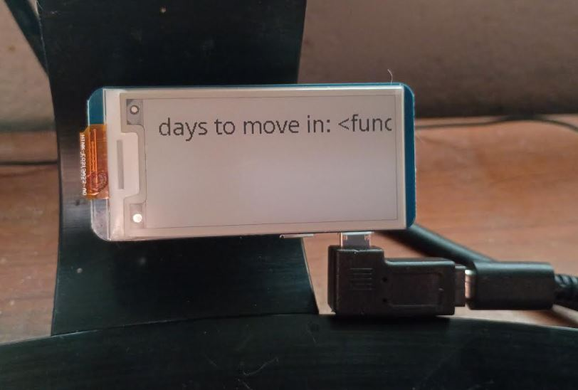
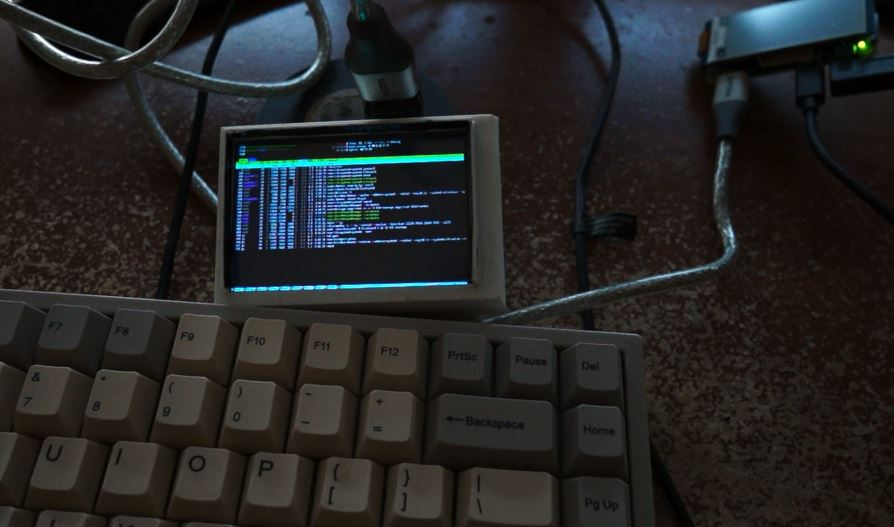
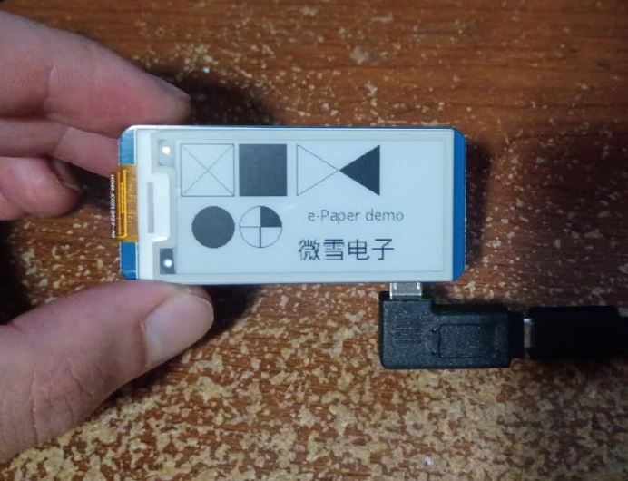
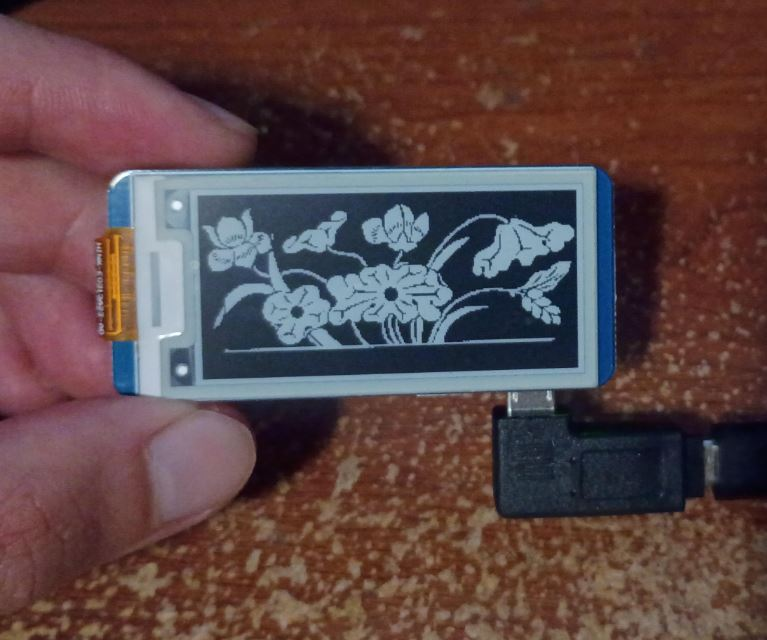

- [ ] get a CRON countdown running

### 10/24/2026

3:08 PM

Alright it's the weekend, I'm broke af, locked into my home since I have no car

Let's do something productive

I want to keep it in the forefront of my mind how many days till I start my new life (really just a new apartment)

But to get to that point is huge and exciting although I kinda wish I picked out a bigger apartment not an askew studio with no bedroom lmao but the savings...

This should be simple the goal is to just display a text which is generated from a function that counts down how many days from Dec 1, 2026 there are.

Then the CRON job will refresh it every hour since the info doesn't have to be refreshed that quickly.

I'm waiting for this video to render that I just made it's 30 mins long.

3:16 PM

Just trying out these different demos

The V2 and V4 demos seem to work the best

I am struggling to motivate myself, I have this feeling of being bored and lonely maybe from not drinking idk, also literally being alone ha

3:27 PM

This is always the hard part when using a library like this, you have to get the path right to reference it in your own code that sits outside of the example folder

Instead of cloing a bunch of random unused files, I'll manually pick out the ones specifically for this 2.13" display I'm using.

3:37 PM

Workout break

4:06 PM

Just put out that Vanta Wing video no workout yet

4:32 PM

I do feel more energized/happier after working out and it's a home workout so that's nice

Alright I'm going to pick out the library files now for this specific display

4:41 PM

Distracted still alright doing it now

5:10 PM

Alright I was able to fix the paths and import only the files being used for this particular e-paper display/demo

Now I have to make my own custom file

5:25 PM

This is kind of funny an exception was thrown since I didn't call this function and it displayed the error or type

5:39 PM

Alright this is pretty cool

So I was going to develop like a desktop app (Electron) and it could have a simulator of this display, then you take whatever image/canvas and turn it into a bitmap send it to this RPi's server and show it... that's all doable and not hard given the rendering part is done already/can reference the example code from waveshare regarding displaying a bitmap.

The thing is I don't plan on customizing this a lot right now. The other problem is the WiFi connection goes down a lot on this maybe from interference with the Pi 4B near it and then proximity to the desktop's hot spot antenna although it's like 2 ft away... idk.

It's not reliable is what I'm saying also the IP keeps changing right now until I connect it to a router, but I can do that project in the future if I want to use this more.

I had envisioned using this to show like my total debt as a clock/daily reminder.

But this is it for now for this project, I'll just add an hourly schedule to run the update via crontab.

Lol as I typed the above it lost connection again to the hotspot ugh.

That's kind of cool you unplug it and the display stays.

crontab should be:

`* * * * * /usr/bin/python /home/pi/e-ink-rpi/code/cron-display.py`

or with logging:

`* * * * * /usr/bin/python /home/pi/e-ink-rpi/code/cron-display.py >> /path/to/file.log 2>&1`

5:50 PM

Ehh of course the paths don't work when ran in cron

6:00 PM

Alright updated it to check path and fix it

---

### 10/22/2026

8:08 PM

Alright so this is pretty annoying and it might be due to interference but this pi zero w on my desk keeps losing the wifi connection.

Specifically to the desktop mobile hotspot next to it.

There is a Pi 4B about a ft away and then a pi zero non-w maybe 5 feet away... another Pi zero w 10 ft away and another like 20 ft away.

This is the one that is having problems though for some reason.

I was looking into this, it is pretty straightforward to get this to work, I should have just RTFM.

Specifically this one:

https://www.waveshare.com/wiki/2.13inch_e-Paper_HAT_Manual#Working_With_Raspberry_Pi

I'll be using Python

It's annoying setting this up, this display is terrible too it's 3.5" but 480x320 resolution really hard to read.

At least a raw HDMI signal

8:17 PM

Today I want to get something displayed on this screen.

I think the main driver or thing I have running in the end is a CRON job that runs a python script that then displays something on the screen.

Specifically it'll countdown how many days I have till I move into my new apartment, that's a nexus point in my life.

If I don't make that I'm f'd I won't die but my life will suck. Like if I don't get into that apartment it means something went wrong and I'm gonna be homeless.

8:24 PM

Ugh it keeps losing connection, the CRON thing my concern is can it keep a clock right without internet assuming it gets disconnected again

Alright doing the work on the pi

9:52 PM

Ayeeee finally, had some problems with my install script I setup

Cool, the flashing clock demo is insane with a refresh rate of like 5 seconds per frame, the full black flash is distracting

---

### 10/21/2026

6:30 PM

Need to find a basic driver to display stuff on the screen. I had tried a JS one in the past but I'll probably just use a python one.

What's annoying is my wifi router broke so I've been using my desktop's hotspot but the IP addresses keep jumping around.

I had to connect this pi to an HDMI display to run `nmtui`.
